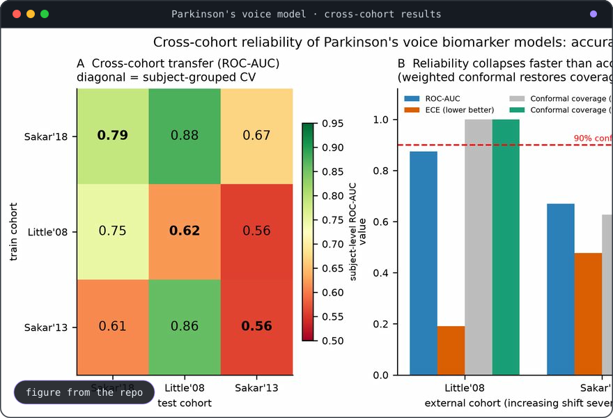
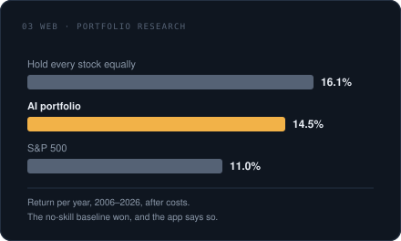
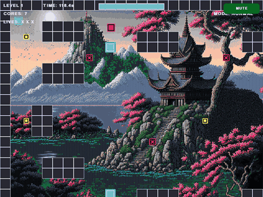

<table>
  <tr>
    <td width="33%" valign="top">
      <h4>Med-tech research</h4>
      
Voice-biomarker models for Parkinson's disease, validated across independent patient cohorts with calibration, domain-shift and leakage analysis. Surgical video segmentation in SurgiVision, lung-tumour CT research in OncoNova AI and on-device wellness signals in Anchor.

    </td>
    <td width="33%" valign="top">
      <h4>Business and finance</h4>
      
Portfolio research for the Wharton Global Youth investment competition: walk-forward models on 74 large-cap stocks, backtested from 2006 to 2026 after costs and measured against honest benchmarks.

    </td>
    <td width="33%" valign="top">
      <h4>Engineering</h4>
      
Python and TypeScript end to end: PyTorch, LightGBM, FastAPI, React, Next.js and Three.js, down to 3D-printed hardware and a Raspberry Pi. Reproducible pipelines, offline test suites, Docker and one-command reruns.

    </td>
  </tr>
</table>

<table>
  <tr>
    <td width="50%">
      <h3><a href="https://github.com/ConnorSawaya/SightSense">SightSense</a></h3>
      
<b>A smart guide cane for people who are blind or have low vision. 🏆 1st place overall, UCSC AI Hackathon @ SF Tech Week 2026.</b> Say where you want to go and a motorised wheel at the tip steers you there around obstacles. An iPhone's camera and LiDAR stream to an ASUS GX10 running the AI locally, which tells a Raspberry Pi on the cane which way to turn the wheel. I designed the 3D-printed hardware (handle, phone mount, wheel adapter, electronics and motor mounts) and the interactive 3D model of the cane. Built with Connor Sawaya, Viraj Rungta and Aryan Kulkarni.

      
<code>iPhone LiDAR</code> · <code>local AI</code> · <code>Raspberry Pi</code> · <code>3D printing</code> · <a href="https://connorsawaya.github.io/SightSense/">3D model</a> · <a href="https://github.com/ConnorSawaya/SightSense">source</a>

    </td>
    <td width="50%">
      
    </td>
  </tr>
  <tr>
    <td width="50%">
      
    </td>
    <td width="50%">
      <h3>SurgiVision</h3>
      
<b>A surgical-vision research lab for gallbladder surgery.</b> Built with <a href="https://github.com/virajrungta">Viraj Rungta</a>. It segments laparoscopic video pixel by pixel, tracks anatomy and instruments from frame to frame, runs an open-source pre-op risk model, and has a simulated smart-glasses voice that reads out what the model sees. Every output is labelled real model, demo or not evaluated. A research prototype, not for clinical use.

      
<code>Python</code> · <code>FastAPI</code> · <code>OpenCV</code> · <code>React</code> · private repo

    </td>
  </tr>
  <tr>
    <td width="50%">
      <h3><a href="https://github.com/a6nkay-source/OncoNova-AI">OncoNova AI</a></h3>
      
<b>A research workstation for lung-tumour CT that says what it doesn't know.</b> It loads DICOM and NIfTI scans with patient geometry tested end to end, outlines tumours with a 3-D U-Net and shows where it is unsure, measures change between scans, and replays a simulated radiotherapy session on a dummy patient. Its demo models were trained on synthetic phantoms; tested on real CT from a public lung dataset they barely transfer (Dice 0.03), and the app says so while real-CT models are trained and compared. A research prototype, not for clinical use, with no connection to any medical device.

      
<code>Python</code> · <code>PyTorch</code> · <code>MONAI</code> · <code>FastAPI</code> · <code>React</code> · <code>Three.js</code> · <a href="https://github.com/a6nkay-source/OncoNova-AI">source</a>

    </td>
    <td width="50%">
      
    </td>
  </tr>
  <tr>
    <td width="50%">
      
    </td>
    <td width="50%">
      <h3><a href="https://github.com/a6nkay-source/Parkinson-Model-Detection">Parkinson's Voice AI</a></h3>
      
<b>Does a voice-based Parkinson's classifier survive new patients?</b> Trained on one public cohort, then tested on completely independent ones: 0.88 AUC on one, 0.67 on another, lifted to 0.75 with label-free adaptation. It measures calibration and domain shift, explains predictions with SHAP, and reproduces two popular repos to show where their accuracy comes from data leakage.

      
<code>Python</code> · <code>LightGBM</code> · <code>SHAP</code> · <code>conformal prediction</code> · <a href="https://github.com/a6nkay-source/Parkinson-Model-Detection">source</a>

    </td>
  </tr>
  <tr>
    <td width="50%">
      <h3><a href="https://github.com/a6nkay-source/Anchor">Anchor</a></h3>
      
<b>A study workspace that watches out for you.</b> Courses, assignments, notes, flashcards and a Socratic AI tutor in one place. While you work it reads posture, gaze and blink rate from the webcam and rhythm from your typing, turns them into a wellness score and a burnout forecast, and nudges you to take a break. Camera frames never leave the browser.

      
<code>Next.js</code> · <code>TypeScript</code> · <code>MediaPipe</code> · <code>Tailwind</code> · <a href="https://github.com/a6nkay-source/Anchor">source</a>

    </td>
    <td width="50%">
      
    </td>
  </tr>
  <tr>
    <td width="50%">
      
    </td>
    <td width="50%">
      <h3><a href="https://github.com/a6nkay-source/Stock-Prediction-Model">AI Stock Research Lab</a></h3>
      
<b>A stock predictor that reports what the models actually did.</b> Built for the Wharton Global Youth investment competition. It scores 74 large-cap US stocks over 1 to 12 months, builds a portfolio for an investor profile, and backtests it over 20 years after costs. The portfolio beat the S&amp;P 500 but lost to simply holding everything equally, and the app says so on the page.

      
<code>TypeScript</code> · <code>React</code> · <code>Python</code> · <code>FastAPI</code> · <a href="https://github.com/a6nkay-source/Stock-Prediction-Model">source</a>

    </td>
  </tr>
  <tr>
    <td width="50%">
      <h3><a href="https://github.com/a6nkay-source/Hydrosense">Hydrosense</a></h3>
      
<b>Water-quality forecasts for US rivers.</b> Started as a physics-informed neural network predicting nitrate risk in Alameda Creek, California, from live stream gauges, weather and satellite imagery. It now forecasts across 359 USGS stations, is validated on stations and states it never trained on, and tracks its own accuracy in a public dashboard.

      
<code>Python</code> · <code>PyTorch</code> · <code>PINN</code> · <code>USGS data</code> · <a href="https://github.com/a6nkay-source/Hydrosense">source</a>

    </td>
    <td width="50%">
      
    </td>
  </tr>
  <tr>
    <td width="50%">
      
    </td>
    <td width="50%">
      <h3><a href="https://github.com/a6nkay-source/Driving-SIm">Drive Mumbai</a></h3>
      
<b>An open-world driving game in the browser, on real Mumbai streets.</b> Colaba to Bandra rebuilt in 3D from OpenStreetMap: Gateway of India, Marine Drive, CSMT, Haji Ali and the Bandra–Worli Sea Link. Drive a sports car, an auto-rickshaw, a kaali-peeli taxi or a BEST bus, or say “Go to Victoria Terminus” in English, Hinglish, Hindi or Marathi and the autopilot drives you there, through traffic, rain and night.

      
<code>TypeScript</code> · <code>Three.js</code> · <code>React</code> · <code>OpenStreetMap</code> · <a href="https://github.com/a6nkay-source/Driving-SIm">source</a>

    </td>
  </tr>
  <tr>
    <td width="50%">
      <h3><a href="https://github.com/a6nkay-source/Neon-Escape">Neon Escape</a></h3>
      
<b>Grab the cores, dodge the enemy, reach the portal.</b> A maze-escape arcade game written in Python with pygame. Three levels, bombs, teleporters, a dash ability, and enemies that hunt you with A* pathfinding. The clip is a recording of the real game.

      
<code>Python</code> · <code>pygame</code> · <code>A* pathfinding</code> · <a href="https://github.com/a6nkay-source/Neon-Escape">source</a>

    </td>
    <td width="50%">
      
    </td>
  </tr>
</table>

  

  Also: <a href="https://github.com/a6nkay-source/pixel_art">pixel art in Python</a> · <a href="https://github.com/a6nkay-source/stanghacks">StangHacks 2026</a> · <a href="https://github.com/a6nkay-source?tab=repositories">all repositories</a>

